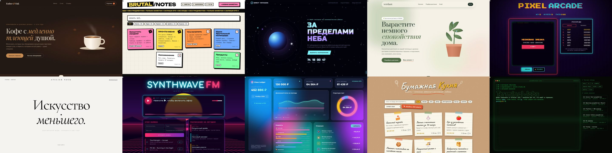

# 10 уникальных сайтов — Ten Unique Websites

Монорепозиторий с **10 полноценными full-stack сайтами на русском языке**. У каждого сайта своя стилистика, типографика и анимации, свой backend на **Node.js + Express** и своя база данных **SQLite**: таблицы, связи, транзакции, валидация и демо-данные. Цены — в рублях, даты — в русском формате, шрифты с кириллицей встроены в проект.



| # | Сайт | Порт | Стиль | Что умеет (backend + БД) |
|---|------|------|-------|--------------------------|
| 01 | **Ember & Oak Roastery** — кофейня | 3001 | Тёплая эспрессо-палитра, зерно плёнки, анимированная чашка с паром, бегущая строка | Меню с фильтрами, корзина, заказы на самовывоз (сумма считается на сервере), отзывы с рейтингом |
| 02 | **BRUTAL/NOTES** — заметки | 3002 | Необрутализм: толстые рамки, жёсткие тени, кислотные цвета | Полный CRUD заметок, теги (many-to-many), закрепление, поиск, статистика |
| 03 | **Orbit Voyages** — космический туризм | 3003 | Звёздное небо на canvas с параллаксом и warp-эффектом, орбиты, glitch-заголовок, 3D-наклон карточек | Направления, рейсы с ограничением мест, бронирование с защитой от овербукинга, поиск брони по коду |
| 04 | **Verdant Plant Studio** — магазин растений | 3004 | Органика: морфинг-блобы, качающееся растение, капли воды, мягкие формы | Каталог с фильтрами и сортировкой, квиз-подбор растения (скоринг на сервере), вишлист на посетителя, рассылка |
| 05 | **Pixel Arcade** — ретро-аркада | 3005 | 8-бит, CRT-развёртка, неон, 8-битный звук на WebAudio | Две играбельные игры (Snake, Reflex), таблица рекордов, игровые сессии-токены и проверка правдоподобности счёта |
| 06 | **Atelier Noir** — модный дом | 3006 | Чёрно-белая редакционная эстетика, кастомный курсор, посимвольное появление текста, горизонтальный лукбук на скролле | Коллекции и образы, лайки, запись на приём со слотами (UNIQUE-ограничение против двойной записи) |
| 07 | **Synthwave FM** — интернет-радио | 3007 | Синтвейв: ретро-солнце, движущаяся неоновая сетка, неоновое мерцание | Генеративная музыка на WebAudio + визуализатор, расписание эфира, очередь заявок с голосованием, кнопка DJ |
| 08 | **Glass Ledger** — финансовый трекер | 3008 | Глассморфизм, северное сияние, анимированные счётчики, собственные графики на canvas | CRUD транзакций, категории с бюджетами, аналитика по месяцам, тренд за 6 месяцев, экспорт в CSV |
| 09 | **Paper Kitchen** — книга рецептов | 3009 | Бумага и пробковая доска, рукописные шрифты, washi-скотч, SVG-каракули, перелистывание страницы | Рецепты с ингредиентами и шагами, масштабирование порций, поиск по ингредиентам, оценки, комментарии, добавление своих рецептов |
| 10 | **Terminal Jobs** — вакансии для разработчиков | 3010 | Интерактивный терминал: загрузка, ASCII-арт, история команд, Tab-автодополнение, «Матрица» | Вакансии, поиск и фильтры, пошаговый отклик и публикация вакансии прямо в терминале, статистика по стеку |

## Быстрый старт

Нужен **Node.js 22.13+**: используется встроенный модуль `node:sqlite`, поэтому нативные зависимости собирать не нужно.

```bash
npm install        # одна установка для всех 10 сайтов (npm workspaces)
npm start          # запускает все сайты сразу на портах 3001–3010
```

Запуск одного сайта:

```bash
npm run start:05   # только Pixel Arcade → http://localhost:3005
# или
cd sites/05-pixel-arcade && npm start
```

Другие команды:

```bash
npm test           # smoke-тесты: поднимает каждый сайт и прогоняет основные API-сценарии (73 проверки)
npm run reset-db   # удаляет все базы, при следующем запуске они создаются и заполняются заново
```

Порт можно поменять через переменную окружения: `PORT=8080 npm start -w sites/01-ember-roastery`.

## Структура

```
ten-unique-websites/
├── package.json            # npm workspaces + общие скрипты
├── scripts/
│   ├── sites.js            # реестр сайтов и портов
│   ├── start-all.js        # запуск всех сайтов с цветными логами
│   ├── smoke-test.js       # автотесты API всех сайтов
│   └── reset-db.js         # сброс баз данных
├── docs/screenshots/       # скриншоты всех экранов каждого сайта
└── sites/
    └── NN-site-name/
        ├── server.js       # Express API + схема БД + сиды
        ├── package.json
        ├── data/           # SQLite-файл (создаётся автоматически, в .gitignore)
        └── public/
            ├── index.html
            ├── fonts/      # встроенные шрифты с кириллицей
            ├── style.css   # вся стилистика и анимации сайта
            └── app.js      # фронтенд-логика (vanilla JS, без фреймворков)
```

## Базы данных

При первом запуске каждый сайт создаёт свою базу `sites/<site>/data/*.db`, накатывает схему и заполняет её демо-данными.

| Сайт | Таблицы |
|------|---------|
| Ember & Oak | `products`, `orders`, `order_items`, `reviews` |
| BRUTAL/NOTES | `notes`, `tags`, `note_tags` |
| Orbit Voyages | `destinations`, `launches`, `bookings` |
| Verdant | `plants`, `wishlist`, `subscribers` |
| Pixel Arcade | `sessions`, `scores` |
| Atelier Noir | `collections`, `looks`, `appointments` |
| Synthwave FM | `shows`, `requests`, `request_votes` |
| Glass Ledger | `categories`, `transactions` |
| Paper Kitchen | `recipes`, `ingredients`, `steps`, `ratings`, `comments` |
| Terminal Jobs | `jobs`, `applications` |

Во всех базах включены WAL и внешние ключи с каскадным удалением, а ограничения заданы через `CHECK` и `UNIQUE`. Многошаговые операции (заказ с позициями, бронирование мест, голосование) выполняются в транзакциях.

## API (кратко)

<details><summary><b>01 Ember & Oak</b></summary>

- `GET /api/products?category=espresso|filter|beans|bakery`
- `POST /api/orders` — `{ customer, email, pickup_time, items: [{id, qty}] }`
- `GET /api/orders/:id`
- `GET /api/reviews` · `POST /api/reviews` — `{ author, rating, body }`
</details>

<details><summary><b>02 BRUTAL/NOTES</b></summary>

- `GET /api/notes?q=&tag=` · `POST /api/notes` · `PUT /api/notes/:id` · `DELETE /api/notes/:id`
- `PATCH /api/notes/:id/pin` · `GET /api/tags` · `GET /api/stats`
</details>

<details><summary><b>03 Orbit Voyages</b></summary>

- `GET /api/destinations` · `GET /api/destinations/:slug` (с рейсами и свободными местами)
- `POST /api/bookings` — `{ launch_id, full_name, email, seats, cabin }` → код `ORB-XXXXXX`
- `GET /api/bookings/:code` · `DELETE /api/bookings/:code` — `{ email }`
</details>

<details><summary><b>04 Verdant</b></summary>

- `GET /api/plants?light=&water=&size=&pet_safe=1&easy=1&q=&sort=`
- `POST /api/match` — `{ light, water, pets, experience }` → топ-3
- `GET /api/wishlist` · `POST /api/wishlist/:plantId` (заголовок `X-Visitor`)
- `POST /api/subscribe` — `{ email }`
</details>

<details><summary><b>05 Pixel Arcade</b></summary>

- `POST /api/sessions` — `{ game }` → `{ token }`
- `POST /api/scores` — `{ token, score, initials }` (токен одноразовый, счёт проверяется по времени игры)
- `GET /api/leaderboard/:game` · `GET /api/games` · `GET /api/stats`
</details>

<details><summary><b>06 Atelier Noir</b></summary>

- `GET /api/collections` · `POST /api/looks/:id/like`
- `GET /api/availability` · `POST /api/appointments` — `{ day, slot, service, name, email, note }`
</details>

<details><summary><b>07 Synthwave FM</b></summary>

- `GET /api/schedule` · `GET /api/now`
- `GET /api/requests` · `POST /api/requests` · `POST /api/requests/:id/vote` · `POST /api/requests/next`
</details>

<details><summary><b>08 Glass Ledger</b></summary>

- `GET /api/categories` · `PATCH /api/categories/:id/budget`
- `GET /api/transactions?month=YYYY-MM` · `POST` / `PUT /:id` / `DELETE /:id`
- `GET /api/summary?month=YYYY-MM` · `GET /api/export.csv`
</details>

<details><summary><b>09 Paper Kitchen</b></summary>

- `GET /api/recipes?q=&tag=&sort=new|top|quick` · `GET /api/recipes/:id` · `POST /api/recipes`
- `POST /api/recipes/:id/rate` · `POST /api/recipes/:id/comments` · `GET /api/tags`
</details>

<details><summary><b>10 Terminal Jobs</b></summary>

- `GET /api/jobs?q=&remote=1&level=` · `GET /api/jobs/:id` · `POST /api/jobs`
- `POST /api/jobs/:id/apply` · `GET /api/stats`
- Команды терминала: `help`, `ls [--remote] [--level=senior]`, `search <term>`, `cat <id>`, `apply <id>`, `post`, `stats`, `whoami`, `matrix`, `clear`
</details>

## Технические детали

- **Без фреймворков на фронтенде**: чистые HTML, CSS и JS. Анимации сделаны на CSS (keyframes, `clip-path`, маски, 3D-трансформации), Canvas 2D и WebAudio.
- **Безопасность**: все SQL-запросы параметризованы, пользовательский текст выводится через `textContent` (без XSS), входные данные валидируются и обрезаются по длине, лимиты на размер JSON, e-mail работодателя в Terminal Jobs не отдаётся наружу.
- **Доступность**: поддержка `prefers-reduced-motion`, фокус с клавиатуры, адаптивная вёрстка под мобильные устройства.
- Шрифты с кириллицей (из пакетов @fontsource, лицензия SIL OFL) лежат в `public/fonts` каждого сайта — сайты работают без внешних CDN.
- Поиск по-русски не зависит от регистра: в SQLite переопределён оператор `LIKE` с Unicode-сравнением.

## Скриншоты

Скриншоты всех экранов лежат в [`docs/screenshots`](docs/screenshots) — по папке на сайт.
